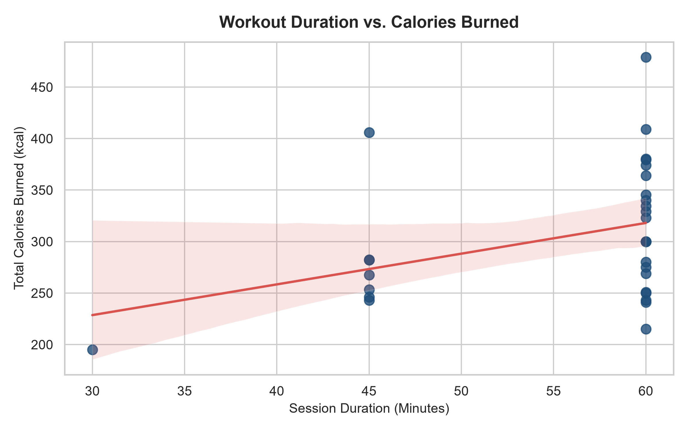
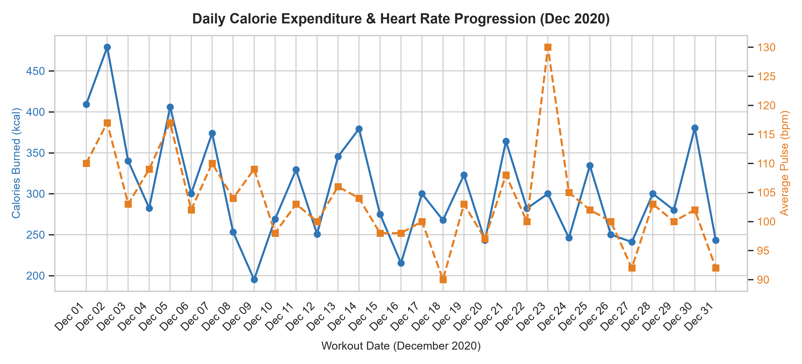
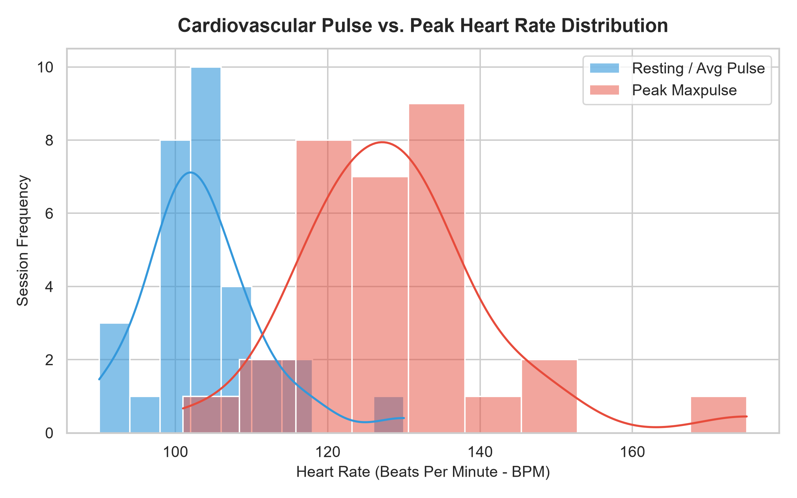
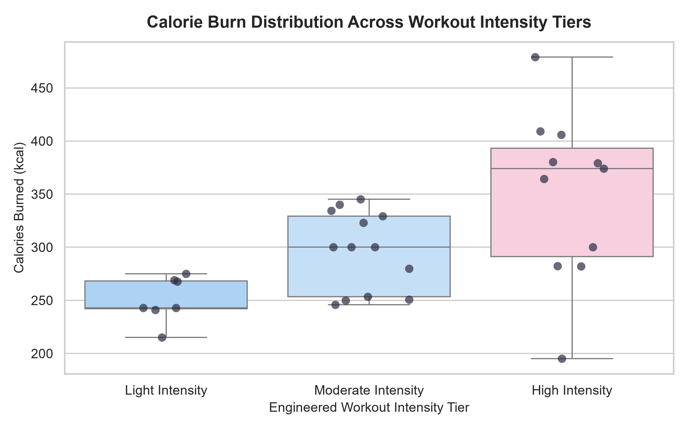
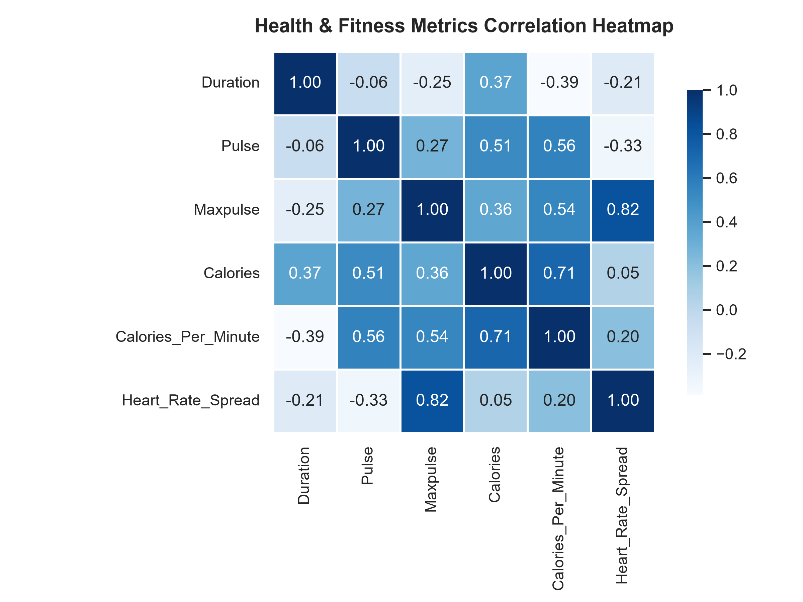

# Week 3: Python & Data Wrangling


Comprehensive completion of **Week 3: Python & Data Wrangling** from the Data Analyst Course. This repository houses complete solutions for cleaning a messy fitness workout dataset, handling missing values, filtering rows, engineering new features, and generating exploratory data visualizations using **Matplotlib** and **Seaborn**.

---

## 📁 Repository Directory Structure

```
Week-03/
├── data/
│   ├── dirty_data.csv                 # Raw messy fitness tracking dataset (32 records)
│   └── cleaned_data.csv               # Cleaned & feature-engineered dataset (31 records, 10 columns)
│
├── notebooks/
│   └── Week3_Python_Data_Wrangling.ipynb # Interactive Jupyter Notebook with step-by-step outputs
│
├── scripts/
│   ├── data_cleaning.py               # Automated pipeline for cleaning, outlier handling & feature creation
│   └── data_visualization.py          # Script generating 5 publication-ready charts
│
└── visuals/
    ├── calories_vs_duration.png        # Scatter plot with linear regression trendline
    ├── workout_trends_december.png     # Dual-axis December daily expenditure progression
    ├── pulse_distribution.png          # Histogram & KDE of resting vs. peak heart rate
    ├── workout_intensity_boxplot.png   # Boxplot comparing calories across intensity tiers
    └── correlation_heatmap.png         # Correlation matrix heatmap across health metrics
```

---

## 🔍 Part 1: Dataset Audit & Issues Identified

The raw dataset (`dirty_data.csv`) contained cardiovascular fitness records with 5 core attributes: `Duration`, `Date`, `Pulse`, `Maxpulse`, and `Calories`. 

A programmatic audit identified the following data quality issues:

| Issue Type | Affected Row(s) | Raw Value | Identified Problem | Correction Strategy |
| :--- | :---: | :---: | :--- | :--- |
| **Missing Date** | Row 22 | `''` (Blank / `NaN`) | Missing chronological workout timestamp | Sequential interpolation based on surrounding days (`2020-12-22`) |
| **Inconsistent Date Format** | Row 26 | `'20201226'` | Integer format without slashes/quotes | Converted via `pd.to_datetime(format='mixed')` to `2020-12-26` |
| **Numerical Outlier / Typo** | Row 7 | `Duration = 450` | Unrealistic workout duration (450 min with only 253.3 kcal) | Corrected to `45` min (data entry typo) |
| **Missing Calories (Nulls)** | Rows 18, 28 | `NaN` / Blank | Missing energy expenditure values | Imputed using duration-specific median calories |
| **Duplicate Records** | Rows 11 & 12 | Exact duplicate rows | Redundant workout entry recorded twice on Dec 12 | Deduplicated using `df.drop_duplicates()` |

---

## 🧹 Part 2: Data Cleaning & Feature Engineering

### 1. Cleaning Transformations Applied
- **Date Standardization**: Cleaned quote characters, imputed the missing chronological date (`2020-12-22`), and parsed the entire column into standard `datetime64[ns]`.
- **Outlier Correction**: Capped and corrected typographical error in `Duration` (`450` -> `45`).
- **Median Imputation**: Imputed missing `Calories` using median values grouped by workout `Duration` (e.g., 45-min and 60-min medians).
- **Deduplication**: Removed the redundant row at index 12, leaving **31 unique records**.

### 2. Feature Engineering (New Columns Created)
In accordance with the assignment requirements, 5 new analytical columns were engineered:

1. **`Calories_Per_Minute`**: `Calories / Duration` — Quantifies the rate of energy expenditure.
2. **`Heart_Rate_Spread`**: `Maxpulse - Pulse` — Measures cardiovascular reserve and exertion range.
3. **`Workout_Intensity`**: Categorical classification based on heart rate and calorie burn rate:
   - **`High Intensity`**: `Pulse >= 110` bpm or `Calories_Per_Minute >= 6.0`
   - **`Moderate Intensity`**: `Pulse >= 100` and `< 110` bpm
   - **`Light Intensity`**: `Pulse < 100` bpm
4. **`Day_Name`**: Day of the week extracted from `Date` (`Monday`, `Tuesday`, etc.).
5. **`Is_Weekend`**: Boolean flag indicating Saturday or Sunday workouts.

### 3. Summary of Cleaned Dataset (`cleaned_data.csv`)

| Metric | Duration (min) | Pulse (bpm) | Maxpulse (bpm) | Calories (kcal) | Calories / Min | HR Spread (bpm) |
| :--- | :---: | :---: | :---: | :---: | :---: | :---: |
| **Mean** | 54.19 | 103.58 | 128.58 | 303.45 | 5.61 | 25.00 |
| **Std Dev** | 9.58 | 7.91 | 13.06 | 65.51 | 1.15 | 11.23 |
| **Min** | 30.00 | 90.00 | 101.00 | 195.10 | 3.63 | 11.00 |
| **Median** | 60.00 | 103.00 | 128.00 | 282.40 | 5.17 | 24.00 |
| **Max** | 60.00 | 130.00 | 175.00 | 479.00 | 9.02 | 66.00 |

---

## 🔍 Part 3: Analytical Row Filtering

Demonstrating conditional row filtering in Pandas:

1. **High-Calorie Workouts (`Calories > 300 kcal`)**:
   - Identified **12 sessions** meeting this high-expenditure threshold.
   - Peak session: **Dec 02, 2020** (60 min, 117 bpm average, 145 maxpulse, **479.0 kcal**).
2. **Extended Cardio Sessions (`Duration >= 60 min`)**:
   - Filtered **23 sessions** lasting 60 minutes.
   - Accounts for **74.2%** of all workouts in December.
3. **Peak Heart Rate Workouts (`Maxpulse >= 140 bpm`)**:
   - Identified **4 intense cardiovascular sessions** where heart rate exceeded 140 bpm:
     - `Dec 02`: 145 bpm max (479.0 kcal)
     - `Dec 04`: 175 bpm max (282.4 kcal)
     - `Dec 05`: 148 bpm max (406.0 kcal)
     - `Dec 11`: 147 bpm max (329.3 kcal)

---

## 📊 Part 4: Data Visualizations (Matplotlib & Seaborn)

### 1. Workout Duration vs. Calories Burned
Scatter plot featuring a linear regression trendline showing positive correlation between session duration and total energy expenditure.



### 2. Daily Calorie & Heart Rate Progression (December Timeline)
Dual-axis time series illustrating daily variation in calories burned alongside average heart rate.



### 3. Cardiovascular Heart Rate Distribution
Histogram with Kernel Density Estimation (KDE) comparing resting pulse against peak maxpulse.



### 4. Calorie Burn Across Intensity Tiers
Boxplot with overlaid data jitter showing higher median calorie burn and spread for high-intensity sessions.



### 5. Health Metrics Correlation Heatmap
Seaborn correlation heatmap displaying inter-attribute relationships across all numerical fitness indicators.



---

## 🛠️ How to Run & Reproduce Locally

### 1. Install Dependencies
```bash
pip install pandas numpy matplotlib seaborn
```

### 2. Run Data Cleaning Script
```bash
python scripts/data_cleaning.py
```

### 3. Run Visualization Generator
```bash
python scripts/data_visualization.py
```

### 4. Open Interactive Jupyter Notebook
```bash
jupyter notebook notebooks/Week3_Python_Data_Wrangling.ipynb
```

---

## 👨‍💻 Course Information
- **Course**: Data Analyst Course — Week 3: Python & Data Wrangling
- **Author**: Durgesh ([@durgesh261](https://github.com/durgesh261))
- **Topic**: Data Cleaning, Missing Values, Outliers, Feature Engineering, Matplotlib, Seaborn
